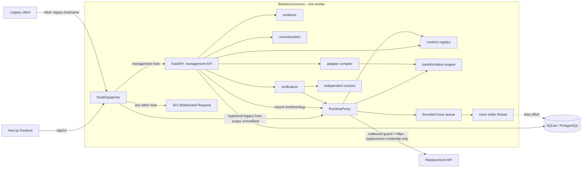

# Design — API Revenant

This is the design summary for the spec. The full documents live in `docs/` and are authoritative:

- #[[file:docs/architecture.md]]
- #[[file:docs/transformation-language.md]]
- #[[file:docs/data-model.md]]
- #[[file:docs/api-contracts.md]]
- #[[file:docs/security.md]]
- #[[file:docs/testing-strategy.md]]
- #[[file:docs/demo-environment.md]]

## Overview

One backend process, with exactly one worker, hosts the management API (`/api/v1`) and the compatibility runtime. The runtime is a single ASGI proxy reachable by path (`/runtime/{slug}`) and by registered legacy hostname through a host-aware dispatcher that is the outermost ASGI application. A Next.js frontend on Netlify consumes the management API. SQLite is used locally and PostgreSQL in production through one SQLAlchemy model set and one Alembic history.

## Architecture



`independent oracles` has no edge to the transformation engine or the adapter compiler; an architecture test enforces this.

## Components and interfaces

| Component | Key interface | Requirements |
|---|---|---|
| `evidence` | `ingest(project, file, side) -> EvidenceRecord`; parsers return facts with locators | 2 |
| `reconstruction` | `reconstruct(project) -> Report(mappings, invariants, gaps, behaviours)`; pure function of normalised contracts and fixtures | 3 |
| `adapter` | `compile(project, approved_mappings) -> AdapterDocument`; `validate(document) -> list[Issue]` | 4, 5 |
| `transform` | `apply(rules, scopes) -> (output, trace)`; pure, no I/O | 6 |
| `runtime` | `normalise_host(raw) -> host \| Rejected`; `HostDispatcher.__call__` (ASGI); `RuntimeProxy.__call__` (ASGI); `RuntimeRegistry.activate/deactivate/recover`; `TracePipeline.offer(trace) -> queued \| dropped`; `InstanceLease.acquire/renew/request_handover/release/may_admit/may_send_upstream`; `RequestDeadline` | 7 |
| `verification` | `plan(inventory) -> list[Check]`; `run(project, adapter_version, layers) -> VerificationRun`; `oracles.*` (independent); `states(inventory, results) -> dict[Behaviour, State]`; `effective_effect(legacy_method, replacement_method, declared) -> Effect`; `authorised(source, effect, permissions) -> bool`; `Dispatcher.send(check)` (re-checks before sending); `score(results, states, weights) -> Metrics` | 8 |
| `security` | `OutboundGuard.check(url)`; `GuardedNetworkBackend.connect_tcp(host, port)` (resolve, validate all, connect to validated address); `extract_query_credential(raw_query, name) -> (value, sanitised_query)`; `InboundKeys.verify(project, presented) -> label \| None`; `OutboundCredentials.active(project, name)`, `.rotate`, `.rollback`; `redact(obj)` | 11 |

## Sequence — one proxied request (host entry)

```mermaid
sequenceDiagram
  participant C as Legacy client
  participant H as HostDispatcher
  participant P as RuntimeProxy
  participant E as Transformation engine
  participant U as Replacement API
  participant Q as Trace queue
  C->>H: POST /v1/charges, Host: api.gravepay.demo:8000, X-API-Key
  H->>H: normalise host, look up host table
  H->>P: ASGI scope unmodified + project id
  P->>P: admission: in-memory lease check, start total-lifetime deadline
  P->>P: extract credential carrier (header or query parameter); only the sanitised request remains
  P->>P: verify legacy key against inbound key hashes, match route
  P->>E: request rules
  E-->>P: upstream request + rule trace
  P->>P: second lease check (abort with 503 if lost or fenced)
  P->>P: snapshot upstream request, then attach replacement credential
  P->>P: pre-send check: legacy key value absent from upstream request
  P->>P: resolve host now, validate every address, connect to a validated address
  P->>U: POST /payments (Bearer replacement credential), timeout = remaining lifetime
  U-->>P: 201 replacement body
  P->>E: response rules / error rules
  E-->>P: legacy response + rule trace
  P-)Q: put_nowait(trace) -> queued or dropped (never waits)
  P-->>C: 201 legacy body, X-Revenant-Trace: queued | dropped
```

## Verification layers

| Layer | Runs | Oracle |
|---|---|---|
| A. Offline historical replay | Engine + adapter, no network | Recorded legacy responses; replacement request schema |
| B. Independent contract and property tests | Legacy-facing outputs; generated requests | Legacy contract as JSON Schema; legacy-only invariants |
| C. Live runtime integration | Full runtime over HTTP to the test target | Recorded legacy responses; legacy-only invariants |

Three traffic sources are distinguished: **offline fixture replay** (layer A; nothing is sent), **live recorded or scripted traffic** (layer C) and **Hypothesis-generated traffic** (layer B property tests).

Every operation has an explicit effect, held on its adapter route: `read_only`, `state_changing` or `unknown`. Unknown is treated as state-changing. Read-only exists only as an approved human declaration; a safe HTTP method alone yields unknown. HTTP method is a floor: an unsafe method on either side is always state-changing, and a read-only declaration on it is rejected.

All traffic permissions default to off:

| Traffic | Operation effect | Required |
|---|---|---|
| Offline fixture replay | any | none |
| Live recorded / scripted | read-only | `allow_replay_traffic` |
| Live recorded / scripted | state-changing or unknown | `allow_replay_traffic` and `allow_state_changing_traffic` |
| Generated | read-only | `allow_generated_traffic` |
| Generated | state-changing or unknown | `allow_generated_traffic` and `allow_state_changing_traffic` |

The planner classifies every request before execution and skips unauthorised checks; the dispatcher independently re-derives the decision from the pinned adapter version immediately before each send. A scripted sequence is blocked as a whole if any step is state-changing or unknown without permission. Each run report discloses state-changing traffic by source and effect. A target may declare sandbox headers and a reset request for isolated, resettable state; the demonstration simulator supports both.

Results are reported in two units. **Checks** are executable tests; **behaviours** are items in a behaviour inventory enumerated from evidence before any test runs. Each behaviour ends a run in exactly one of five states, which sum to the inventory size N:

| State | Meaning |
|---|---|
| Verified (P) | Evidence available and successfully tested |
| Failed (F) | Evidence available but a test failed |
| Not executed (X) | Evidence available but the test could not execute (skipped or error) |
| Unresolved (U) | Planned but unsupported by evidence |
| Not assessed (A) | Not yet assessed (unsupported by the product, or marked out of scope) |

Two separate metrics:

- **Behavioural compatibility** — per-category pass rate over executed checks, weighted 0.30 / 0.30 / 0.20 / 0.20, averaged over endpoint groups plus one project-level group for behaviours that belong to no endpoint. Always displayed with both "(P + F) of N behaviours" and "(passed + failed) of K planned executable checks".
- **Evidence coverage** — `(P + F + X) / N`. Always displayed with that numerator and denominator.

Unresolved and Not assessed behaviour is never in a numerator and always in the denominators. A verified behaviour with a skipped or errored check is shown as partially verified.

Inventories are versioned. Each reconstruction records the evidence version it analysed and owns an immutable inventory; evidence imported later makes the reconstruction stale and enters an inventory only through a new reconstruction. Verification refuses to run on a stale reconstruction. Every run records its evidence version, inventory and denominators at start, and a completed run is never modified. Formulas, presentation rules and circularity controls: `docs/architecture.md` §5–§6.

## Sequence — restart recovery

```mermaid
sequenceDiagram
  participant A as App lifespan
  participant D as Database
  participant R as Registry
  A->>A: single-worker configuration check (fail fast)
  A->>D: connectivity check (bounded retry)
  A->>D: acquire instance lease (atomic; exit if sibling worker; standby and request handover if another process holds it)
  A->>D: load runtime_hosts into host table
  A->>D: select runtime_instances where desired_state = running
  loop each instance
    A->>D: load pinned adapter_version
    A->>A: validate document, resolve credentials
    alt valid
      A->>R: load compiled adapter
      A->>D: status = running, lifecycle event
    else invalid
      A->>D: status = failed, last_error
    end
  end
  A->>D: mark interrupted verification runs errored
  A->>A: start trace writer, report ready
```

## Data models

See `docs/data-model.md`. Core relationships: a project owns evidence files, endpoints (with provenance facts), fixtures and paired recordings, reconstructions (mappings, invariants, gaps), adapter versions, verification runs (test results), one runtime instance (events), runtime hosts, inbound keys (hashed) and outbound credentials (encrypted, versioned). `instance_lease` is a single system-wide row.

## Error handling

- Management API: one error envelope with stable codes; validation errors list fields.
- Runtime: transformation errors → legacy-shaped `400`/`502`; legacy key rejected → `401` with no upstream call; upstream timeout → `504`; upstream connection failure or upstream rejecting the replacement credential → `502`; runtime not serving → `503`. Each outcome has a code; it is stored as a runtime event only if its trace is persisted.
- Trace failures (queue full, persistence error, shutdown) never affect the proxy response; they are counted, logged, reported in health and summarised in a `trace_loss` event.
- Evidence parsing never raises to the user as a 500; failures become a stored parse report.
- Background failures (trace writer, lease heartbeat, verification run) are logged and surfaced through health or run status.

## Testing strategy

See `docs/testing-strategy.md`. Product verification has three layers (offline replay, independent contract and property tests, live integration). The project's own suite adds unit, engine property, integration, security, resilience (restart, trace pipeline, worker constraint, concurrency, database loss), architecture (import rules) and one end-to-end acceptance test that runs the unchanged legacy client.

## Decisions and constraints

- Runtime is ASGI-mounted; no dynamic listeners.
- Legacy hostnames are routed by an in-process host dispatcher that passes the request through unmodified. Hosts are strictly normalised and matched exactly; malformed hosts get `400`, unexpected hosts `421`; forwarded-host headers are untrusted by default; the management API is never served on a legacy hostname.
- Legacy-client keys and the replacement-provider credential are separate stores; the legacy key is never forwarded.
- Tracing is bounded and best-effort; it never blocks requests and never claims persistence it did not achieve.
- Adapters are declarative data; no generated code is executed.
- Verification oracles are independent of the engine; expectations come only from evidence.
- Deterministic proposers only; no LLM in this release.
- Single tenant; one admin token.
- Exactly one worker and one instance. Multi-worker configurations are rejected at start-up. A single-row database lease with self-fencing is designed to prevent two processes serving at once; it adds no infrastructure. It holds under stated assumptions (clock-rate divergence within the margin, detectable pauses, a consistent lease store) and there is no upstream fencing token.
- Every runtime request has one total lifetime limit covering body read, upstream call and response. Lease timing is `TTL ≥ grace + request lifetime + clock margin`. On ownership loss in-flight requests are cancelled; on handover they are drained before the lease is released.
- An inbound credential carried in a query parameter is removed at extraction; only the sanitised query is processed, traced or logged. The server access log is disabled.
- Outbound connections resolve immediately before connecting, validate every address, connect to the validated address with no second resolution, and keep hostname-based TLS verification and SNI. The client is `httpx` on an `httpcore` pool with a custom network backend; feasibility is demonstrated by the executable spike in `spikes/outbound_transport`.
- Verification never exercises a state-changing or unknown operation on a test target, from recorded or generated traffic, unless `allow_state_changing_traffic` is enabled, and discloses it when it does. Operation effect is an explicit, approved classification; HTTP method is only a floor.
- Linux CI is the gate for the outbound transport: application code does not use it until the complete spike suite has passed on Linux with pinned dependencies.
- Render is the only supported backend target.
- Serving through a database outage is bounded by the lease grace period.
- Evidence coverage uses a fixed behaviour inventory as its denominator, so unknown and untested behaviour cannot be hidden.
